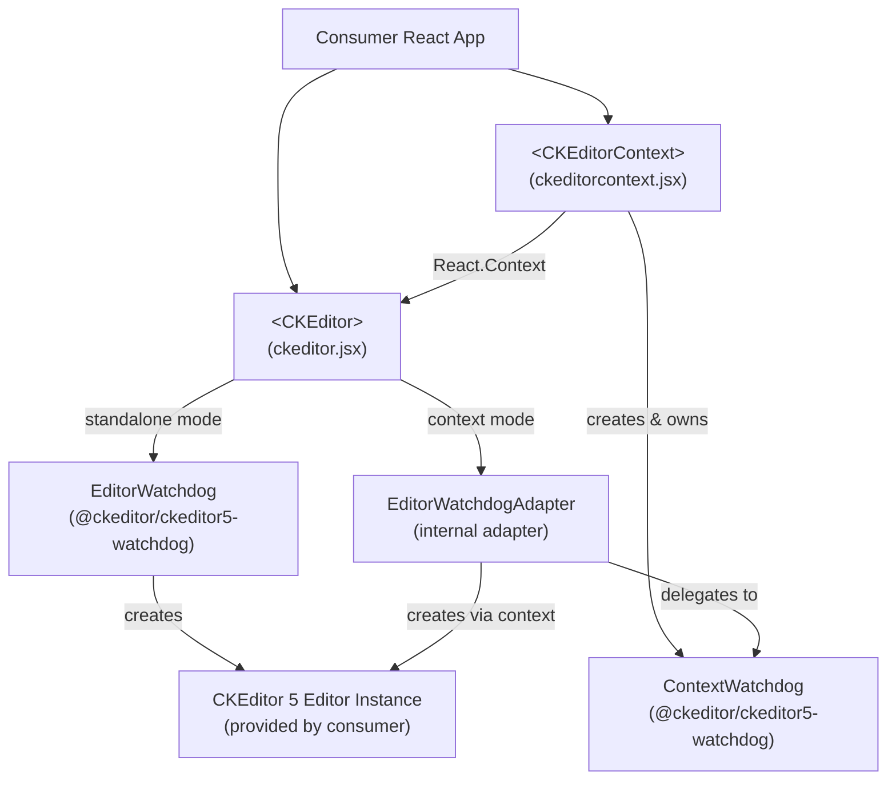

# ckeditor5-react Architecture

## System Overview

`@ckeditor/ckeditor5-react` is a thin React integration layer for CKEditor 5. It exports two React class components — `CKEditor` and `CKEditorContext` — that manage editor instance lifecycle, watchdog-based error recovery, and bidirectional synchronization between React props and the CKEditor 5 API. The library does not bundle an editor; consuming applications supply their own CKEditor 5 build.

## Architecture Diagram

## Component Map

| File | Responsibility | Key Dependencies |
|------|---------------|-----------------|
| `src/ckeditor.jsx` | `<CKEditor>` React component — mounts/destroys editor, syncs `data`, `disabled`, and event props | `EditorWatchdog`, `ContextWatchdog` (via context), `uid` |
| `src/ckeditorcontext.jsx` | `<CKEditorContext>` — creates a shared `ContextWatchdog`, exposes it via React context | `ContextWatchdog` |
| `src/index.js` | Public entry point — re-exports `CKEditor` and `CKEditorContext` | — |
| `tests/ckeditor.jsx` | Unit tests for `<CKEditor>` | Enzyme, Mocha/Chai/Sinon |
| `tests/ckeditorcontext.jsx` | Unit tests for `<CKEditorContext>` | Enzyme, Mocha/Chai/Sinon |
| `tests/integrations/` | Integration tests for editor + context together | — |
| `tests/issues/` | Regression tests tied to specific bug reports | — |
| `tests/_utils/` | Shared mock `Editor` and `Context` objects for tests | — |
| `tests/_utils-tests/` | Tests for the test utilities themselves | — |
| `scripts/test.js` | Karma server launcher (accepts CLI args) | `karma` |
| `scripts/utils/getkarmaconfig.js` | Karma + Webpack config generator | `webpack`, `babel-loader` |
| `webpack.config.js` | Production build config — UMD bundle, externalizes React | `webpack`, `terser-webpack-plugin` |
| `sample/` | Runnable sample apps for manual testing | `@ckeditor/ckeditor5-build-classic` |

## Data Flow

### Editor Initialization
1. Consumer renders `<CKEditor editor={ClassicEditor} data="..." config={{...}} />`
2. `componentDidMount` calls `_initializeEditor()`
3. If a `ContextWatchdog` is provided via React context, an `EditorWatchdogAdapter` is created; otherwise a standalone `EditorWatchdog`
4. Watchdog's `create()` is called with the DOM container ref and merged config
5. On success, event listeners are attached for `change:data`, `focus`, `blur`; `onReady` fires via `setTimeout`

### Prop Updates (React reconciliation)
- `shouldComponentUpdate` intercepts React updates
- If `data` changed and differs from editor content, `editor.setData()` is called directly — no re-render
- If `disabled` changed, `enableReadOnlyMode` / `disableReadOnlyMode` is called directly — no re-render
- Returns `false` (prevents React re-render) unless `id` prop changed (forces full destroy + recreate)

### Context Mode
- `<CKEditorContext context={Context} config={...}>` creates a `ContextWatchdog` and exposes it via `ContextWatchdogContext`
- Child `<CKEditor>` components detect the context via `contextType = ContextWatchdogContext`
- `EditorWatchdogAdapter` translates the `ContextWatchdog` multi-editor API into the single-editor `EditorWatchdog` API

## Key Design Decisions

### Watchdog Pattern for Error Recovery
All editor instances are managed through `EditorWatchdog` or `ContextWatchdog` from `@ckeditor/ckeditor5-watchdog`. If the editor crashes, the watchdog automatically reinitializes it. Errors surface via `onError(error, { phase, willEditorRestart })`.

### CKEditor Owns Its DOM — React Does Not
`shouldComponentUpdate` returns `false` by default. React never diffs or patches the editor DOM; CKEditor manages it entirely. This avoids conflicts between React's virtual DOM and CKEditor's document model.

### CKEditor 5 v34+ Lock Mechanism Required
Read-only mode uses `editor.enableReadOnlyMode(lockId)` / `editor.disableReadOnlyMode(lockId)`. This lock-based API was introduced in CKEditor 5 v34 (a breaking change). The component warns at runtime if an older version is detected via `window.CKEDITOR_VERSION`.

### Editor Build Provided by Consumer
The library ships no CKEditor build. Consumers pass their editor class as the required `editor` prop. This keeps the package small and lets applications choose their feature set.

### UMD Build, React Externalized
Webpack builds a UMD bundle (`dist/ckeditor.js`) that externalizes React — it is not bundled. Only the `dist/` directory is published to npm.

## External Dependencies

| Package | Purpose | Used In |
|---------|---------|---------|
| `react` | Component lifecycle, refs, context | `src/` (peer dep) |
| `prop-types` | Runtime prop validation | `src/` (runtime dep) |
| `@ckeditor/ckeditor5-watchdog` | `EditorWatchdog`, `ContextWatchdog` | `src/ckeditor.jsx`, `src/ckeditorcontext.jsx` |
| `@ckeditor/ckeditor5-utils` | `uid()` for unique adapter IDs | `src/ckeditor.jsx` |
| `@ckeditor/ckeditor5-build-classic` | Provides a real editor instance for tests | `scripts/utils/getkarmaconfig.js` |

## Cross-Cutting Concerns

### Build
Webpack produces a single UMD file (`dist/ckeditor.js`). JSX is transpiled with `@babel/preset-react`. `TerserPlugin` minifies while preserving CKEditor license banner comments.

### Testing
Tests run in a real browser (Chrome) via Karma. Enzyme mounts full React component trees. Istanbul (via `babel-plugin-istanbul`) instruments `src/` for coverage. Test utilities in `tests/_utils/` provide stub `Editor` and `Context` objects that do not require a real browser DOM from CKEditor.

### Linting
ESLint with `eslint-config-ckeditor5` and `plugin:react/recommended`. `babel-eslint` parser handles JSX. Pre-commit hook (Husky + lint-staged) runs ESLint on staged `.js`/`.jsx` files.
